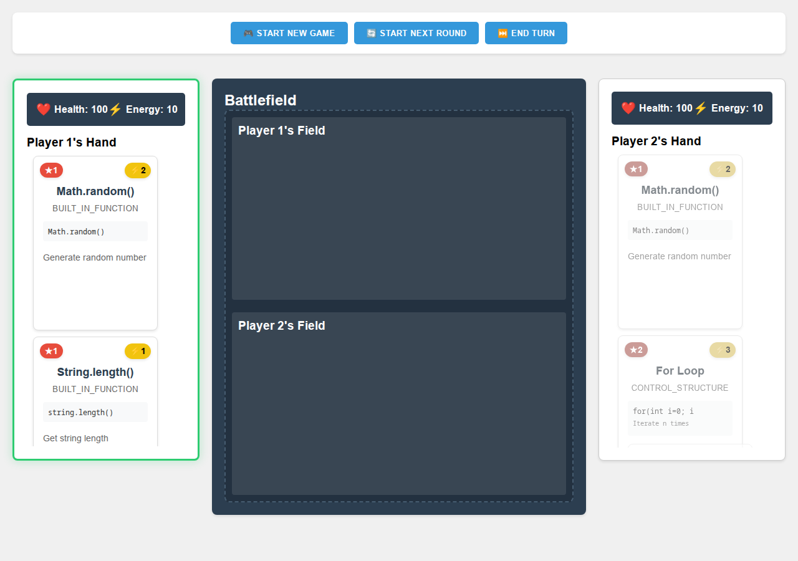

# Programming Card Game

A two-player card game where the cards are programming concepts: built-in functions, variables, operators, control structures and functions. Players spend energy to play cards onto the battlefield, combine them, and chase goals such as reaching a code complexity or building a function.

A course project from the Lexicon Java developer programme (December 2024). The game is a prototype, not finished, but the full loop runs: start a game, draw, play cards, end turns, next round.



**Live demo:** [programming-card-game.onrender.com](https://programming-card-game.onrender.com)
(Free hosting: the first load can take about a minute while the server wakes up.)

## How it's built

- **Backend:** Java 21, Spring Boot, Gradle. A REST API with services for the deck, rules, card combinations and goals.
- **Frontend:** one static HTML page with vanilla JavaScript, served by Spring Boot.
- **Deploy:** Docker image on Render, with a production profile for CORS.

## Run it locally

```bash
./gradlew bootRun
# open http://localhost:8080
```

## API

```bash
# Start a new game
curl -X POST http://localhost:8080/api/game/start \
  -H "Content-Type: application/json" \
  -d '["Player1", "Player2"]'

# Player status
curl http://localhost:8080/api/game/player/Player1

# Play a card
curl -X POST "http://localhost:8080/api/game/play?playerName=Player1&cardName=Print%20Function"

# Next round
curl -X POST http://localhost:8080/api/game/next-round
```
